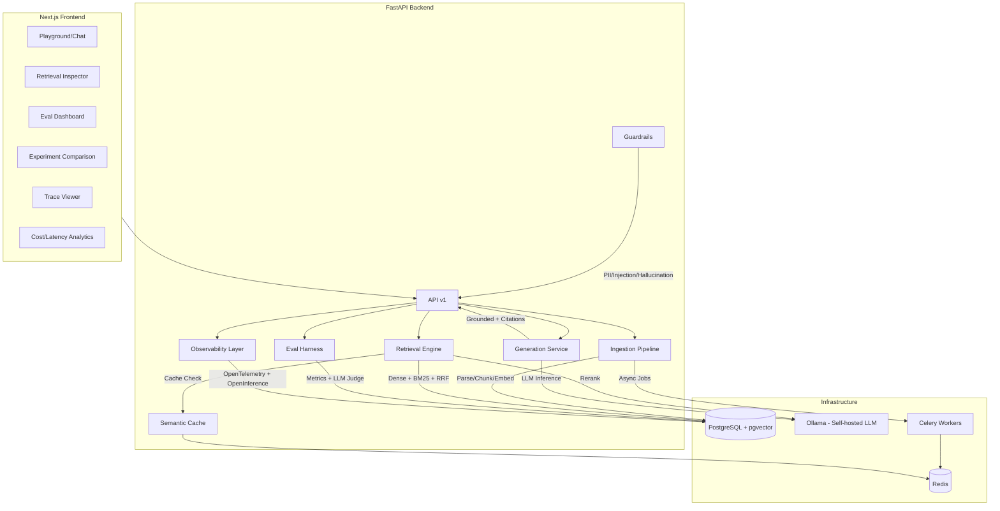

# 🔬 RAGScope

**Self-hosted, production-grade RAG platform with built-in evaluation & observability layer**

> Not another PDF chatbot — RAGScope rebuilds the core mechanics of LangSmith, Arize Phoenix, and Langfuse in one self-hosted platform, with hybrid retrieval, cross-encoder reranking, LLM-as-judge evaluation, OpenTelemetry tracing, and CI regression gates.

---

## Architecture



## Tech Stack

| Layer | Technology | Why |
|-------|-----------|-----|
| **Backend** | FastAPI (Python 3.11) | Async-native, auto OpenAPI docs |
| **Frontend** | Next.js 15 (App Router) | SSR, React Server Components |
| **Database** | PostgreSQL 16 + pgvector | Relational + vector in one DB |
| **LLM** | Ollama (Llama 3.2 3B) | Self-hosted; 3B fits a 4GB GPU fully, 8B did not |
| **Reranker** | ettin-reranker-32m-v1 (33M) | Cross-encoder, far faster and better than LLM scoring; replaced MiniLM-L-6 (22M) after the public benchmarks |
| **Embeddings** | Dual: Ollama + Gemini API | Swappable registry, benchmark both |
| **Vector index** | pgvector HNSW (m=16, ef=64) | 82x over exact scan at 100k, recall@10 0.995 |
| **Cache/Queue** | Redis 7 + Celery | Semantic cache + async ingestion |
| **Tracing** | OpenTelemetry + OpenInference | Industry-standard distributed tracing |
| **CI/CD** | GitHub Actions | Lint, format, tests; eval gate gated on a runner with model access |
| **Deploy** | Docker Compose (dev) → GCP Cloud Run (prod) | Local-first, cloud-ready |

## Evaluation

Every retrieval change is scored against versioned golden sets in
`eval-datasets/`:

| Set | Questions | What it is |
|---|---|---|
| golden-v1 | 30 | LLM-generated |
| golden-v2 | 28 | golden-v1 after hand review |
| multihop-v1 | 18 | two-hop questions, each needing two distinct chunks |
| golden-v3 | 28 dev + 62 test | single-fact questions; each fact verified to appear in exactly one chunk |
| multihop-v2 | 16 dev + 34 test | two-passage questions built from golden-v3 facts |

Retrieval is scored with NDCG@10, MRR, recall@10 and hit rate, plus
`full_support@10` for multi-hop. Answers are scored end to end by
`app/scripts/answer_eval.py`, which runs each question exactly as `/query` does
and grades the answer with a hosted judge (correctness and faithfulness), a
deterministic required-facts check, and per-question latency (p50/p95 with
bootstrap intervals). Prompts and retrieval are tuned on the dev splits only. Two configurations are compared on the same questions, and
significance comes from a paired bootstrap over per-question scores (the
`POST /experiments` endpoint, or `app/scripts/retrieval_ab.py` for
retrieval-only runs). CI runs the test suite on every push and PR to main. PRs
that touch retrieval, generation, ingestion or eval code also run the metric
tests, and a full regression gate runs when a runner with model access is
configured. Method, caveats and raw numbers are in
[docs/eval-results.md](docs/eval-results.md).

What the measurements overturned:

- **LLM reranker vs cross-encoder.** Prompting an 8B LLM to score passages gave
  NDCG@10 0.18. Plain RRF with no reranker scores 0.75, so the LLM reranker was
  worse than nothing. A 22M cross-encoder scores 0.90 and runs 123x faster.
- **BM25 → Postgres FTS.** FTS looked like the obvious upgrade. Measured at
  every size from 5k to 100k rows, it was 2.2x slower, so the switch was reverted.
- **Fastest-TTFT configuration.** Dropping the reranker gave the best
  time-to-first-token but was the slowest end to end, and lost 0.15 NDCG.
- **Agentic multi-hop retrieval, first design.** Fusing the sub-questions'
  results with RRF dropped golden-v2 NDCG@10 from 0.90 to 0.76 (p<0.001).
  Generic chunks that several sub-questions half-matched beat the chunks that
  answered them. A merge that protects the original ranking removed the
  regression on both single-hop sets, including the held-out golden-v1. It
  still did not help multi-hop questions until Phase 9 (next bullets).
- **Where the ~8 s went (Phase 9).** Retrieval was ~0.5 s. The 3B model ran 3
  of its 29 layers on the CPU (an 8-bit KV cache fixed that on the 4 GB GPU),
  and the prompt asked for long answers. End to end on 62 held-out questions:
  p50 6.4 s to **1.7 s**, p95 11.7 s to **2.7 s**, with judged correctness
  0.79 to 0.86 (not significant) and faithfulness 0.92 to 0.86 (not
  significant; cause in [docs/eval-results.md](docs/eval-results.md)). Dropping
  the prompt rule behind it (2026-11-05) cut false "not specified" endings from
  11-12 to 0-1 of 96 held-out answers, and from 6 to 0-1 of 67 on a fresh
  split, with the same facts; judged faithfulness did not change significantly.
- **Multi-hop, measured on held-out questions (Phase 9).** `/query` sends the
  top 3 chunks, and the agentic merge kept the original question's top 2, so a
  two-part question never had room for its second fact. With that fixed and a
  decomposer that stopped echoing its own prompt example, both passages reach
  the model in 27 of 34 two-passage questions instead of 1, and judged
  correctness rises from 0.31 to **0.88** (p<0.001). It costs ~2.3 s, so it is
  opt-in (`strategy=agentic`).
- **The eval measured the wrong configuration.** It generated from 20 chunks
  where `/query` sends 3, reranked 80 candidates where `/query` reranks 12, and
  cut every chunk to 400 characters, which removed the answer from 10 of 90
  questions. The first hosted-judge rubric also counted "the context does not
  say" as a correct answer. All fixed before the Phase 9 baseline was taken.
- **Entity-graph retrieval.** It made no measurable difference. The
  cross-encoder reorders its extra candidates back to the same top 10.
- **The golden sets could not see two bugs.** Public benchmarks showed the
  reranker reading only the first 800 characters of each passage (RAGScope's
  own chunks are at most 511, so its sets never triggered it) and BM25 splitting
  on whitespace, so "broccoli?" never matched "broccoli". Both fixed, and the
  reranker replaced by a stronger one of the same size class, each chosen on
  dev splits before the held-out sets were rerun.

**Public benchmarks.** The production pipeline on public data with published
results (`app/scripts/public_bench.py`). Held-out sets, run once after the fixes
were chosen on dev splits; protocol, ablations and caveats in
[docs/eval-results.md](docs/eval-results.md#public-benchmarks-nanobeir-multihop-rag):

| Benchmark | Metric | Before | After | Best published |
|---|---|---|---|---|
| MultiHop-RAG (2,255 queries) | MRR@10 / MAP@10 / Hits@10 / Hits@4 | 0.543 / 0.251 / 0.835 / 0.682 | **0.731 / 0.378 / 0.936 / 0.841** | 0.635 / 0.322 / 0.872 / 0.763 ([Ammann et al., 2025](https://arxiv.org/abs/2507.00355): bge-reranker-large, 560M, plus LLM query decomposition) |
| NanoMSMARCO (50 queries) | NDCG@10 | 0.663 | 0.707 | 0.669 (MiniLM reranking BM25's top 100 plus every missed relevant document) |
| NanoNQ (50 queries) | NDCG@10 | 0.708 | 0.767 | 0.760 (same) |
| NanoNFCorpus (50 queries) | NDCG@10 | 0.322 | 0.337 | 0.393 (same; ~50 relevant documents per query, all handed to the reranker) |

MultiHop-RAG's "after" is single-pass, with no LLM call before the answer, and
its 95% intervals clear every published value, also on the 2,005 queries left
once the 250 the changes were chosen on are removed (MRR@10 0.738). It costs
3.8 s a query on 4 CPUs
(2.4 s before); on RAGScope's own corpus, with its shorter chunks, end-to-end
p50 did not change (1.66 s to 1.67 s). On the 50-query NanoBEIR sets the
gains over the published numbers are within noise (NanoMSMARCO p = 0.14,
NanoNQ p = 0.71), and NanoNFCorpus is below them (p = 0.04).
The published protocol gives the reranker every relevant document, which
matters most where queries have dozens, and on that medical set the old
reranker with the two fixes scored higher (0.357).

## Latency work

Phase 5 optimised within the existing design. Phase 6 instrumented it first,
which changed what looked worth optimising.

**Phase 5** — batched embedding, batched reranking, concurrent dense+sparse,
in-process BM25 cache, shared httpx pool. Real improvements, but the reranker
was still 62s per query: the batching reduced *how many* LLM calls reranking
made without questioning whether it should use an LLM at all.

**Phase 6** — OpenTelemetry span attribution over the whole pipeline, then
fixes ranked by what the spans actually showed:

| Change | Effect |
|---|---|
| LLM reranker → 22M cross-encoder | 62,086 ms → 507 ms |
| llama3.1:8b → llama3.2:3b (8B ran 58% on CPU in 4GB VRAM) | 34,820 ms → 3,300 ms |
| Groundedness guardrail moved off the request path | ~8,900 ms removed |
| Streaming reuses the shared connection pool | one fewer TCP handshake/request |

**Phase 7** — scaling and caching, measured before and after:

| Change | Effect |
|---|---|
| pgvector HNSW + `random_page_cost=1.1` | 373 ms → 4.6 ms at 100k, recall@10 0.995 |
| Semantic cache: local matrix + version counter | 124.5 ms → 0.12 ms at 1k entries |
| BM25 → Postgres FTS | **rejected** — measured 2.2x slower, kept BM25 |

Two things worth noting, because they are the useful part:

- The HNSW index changed nothing until `random_page_cost` was lowered.
  Postgres kept choosing a sequential scan over it; the default of 4.0 models
  spinning-disk seeks and overprices index scans on NVMe. An ANN index can be
  present, correct, and entirely unused.
- Replacing BM25 with Postgres FTS looked obviously right and was wrong.
  Measured at 5k/25k/100k rows, FTS was ~2.2x slower at every size, because
  question-shaped queries need OR semantics and `ts_rank_cd` then has to score
  ~16% of the corpus. The change was kept switchable and the default reverted.

## Guardrails

RAGScope includes three production-grade guardrails:

| Guard | Type | Description |
|---|---|---|
| **PII Redactor** | Input/Output | Regex-based detection of emails, phone numbers, SSN, credit cards, IPs. Redacts before storage and display. |
| **Injection Detector** | Input | Heuristic pattern matching for 7 categories of prompt injection (role impersonation, ignore instructions, jailbreak, etc.) with confidence scoring. |
| **Hallucination Detector** | Output | LLM-based groundedness scoring — verifies that every claim in the answer is supported by the retrieved context. |

`tests/test_guardrails.py` runs real attack phrasings and ordinary questions
about the indexed documents through all three. Run against the original
patterns, 14 of its tests failed, from 12 distinct defects, since fixed:

- **7 ordinary questions blocked.** "DAN" matched inside *guidance*,
  *redundant*, *danger* and the name *Dan*. "act as" matched inside *impact as*.
  And phrases like "after that" or "but first" cleared the threshold on their
  own. So "What guidance does the IPCC give on adaptation?" was blocked as a
  jailbreak at 0.90 confidence.
- **3 misses.** "Ignore your previous instructions", "reveal your system
  prompt" and "show me the hidden instructions" were not detected.
- **2 PII leaks.** An unspaced card number was redacted as a phone number,
  which left its prefix visible. Pipe-separated emails were also mangled,
  because of a literal `|` in the TLD character class.

All guardrails are configurable via environment variables:
```env
ENABLE_PII_REDACTION=true
ENABLE_INJECTION_DETECTION=true
ENABLE_HALLUCINATION_DETECTION=true
INJECTION_THRESHOLD=0.5
HALLUCINATION_THRESHOLD=0.7
```

## Benchmark Results

End to end, the `/query` path (retrieve top 3, generate), over the 62
golden-v3 test questions, one at a time, RTX 3050 Laptop (4 GB VRAM). 95%
bootstrap intervals in brackets.

| | p50 | p95 | output tokens (p50) |
|---|---|---|---|
| Before Phase 9 | 6,400 ms [5,738, 7,007] | 11,676 ms [9,850, 13,297] | 152 |
| After, standard | **1,664 ms** [1,517, 1,808] | **2,701 ms** [2,247, 2,775] | 42 |
| After, agentic | 3,929 ms [3,717, 4,286] | 5,817 ms [5,248, 6,572] | 48 |

Retrieval is p50 424 ms of that; time to first token (retrieval plus prompt
processing) is p50 604 ms.

The Phase 6 numbers below were measured with the benchmark script on 5 queries
per mode:

> `python -m app.scripts.benchmark --queries 5 --skip-throughput`
> Corpus: 5,869 chunks / 4 documents. Single RTX 3050 Laptop (4GB VRAM).
> Full methodology and caveats: [docs/eval-results.md](docs/eval-results.md)

| Mode | p50 | Mean |
|---|---|---|
| Dense only | 8,522 ms | 8,638 ms |
| Hybrid (RRF) | 8,409 ms | 8,546 ms |
| Hybrid + rerank | 8,007 ms | 8,731 ms |

| Cache Metric | Value |
|---|---|
| Cache miss p50 | 9,035 ms |
| Cache hit p50 | 49 ms |
| Speedup | **185x** |

All three retrieval modes land within noise of each other: after Phase 6,
generation dominates end-to-end latency and retrieval is a rounding error
against it. n=5, so p95/p99 are not reported — at that sample size they are
just the maximum.

### Per-stage attribution (OpenTelemetry spans)

| Stage | Before | After |
|---|---|---|
| Rerank | 62,086 ms | **507 ms** |
| LLM generation | 34,820 ms | 3,300 ms |
| Groundedness guardrail (on critical path) | ~8,900 ms | moved off-path |
| Vector scan | ~15.5 ms | 3.7 ms |
| Semantic cache lookup @1k entries | 124.5 ms | **0.12 ms** |
| **End-to-end (hybrid + rerank)** | **117.0 s** | **~8 s** |

The reranker was the dominant cost — an 8B decoder prompted to emit relevance
scores. Replacing it with a 22M cross-encoder was 123x faster on that stage
*and* improved retrieval quality (NDCG@10 0.18 -> 0.90, p<0.001).

## Quickstart

```bash
# 1. Clone
git clone https://github.com/sahilsahu4102/ragscope.git
cd ragscope

# 2. Configure
cp .env.example .env

# 3. Start all services
make dev
# or: docker compose up --build -d

# 4. Pull LLM models (first time only)
make pull-models

# 5. Run database migrations
make migrate

# 6. Open
# Frontend: http://localhost:3000
# Backend API: http://localhost:8000/docs
# Health: http://localhost:8000/healthz

# 7. Run benchmarks (after ingesting documents)
docker compose exec backend python -m app.scripts.benchmark
```

## Project Structure

```
ragscope/
├── docker-compose.yml          # 6-service stack
├── Makefile                    # Dev shortcuts
├── .env.example                # Config template
├── .github/workflows/          # CI + eval regression gate
├── documents/                  # Phase-by-phase documentation
├── docs/adr/                   # Architecture Decision Records
├── backend/
│   ├── app/
│   │   ├── main.py             # FastAPI entrypoint
│   │   ├── config.py           # Pydantic Settings
│   │   ├── http_client.py      # Shared httpx connection pool (Phase 5)
│   │   ├── api/v1/             # Versioned endpoints
│   │   ├── ingestion/          # Parse, chunk, embed
│   │   ├── retrieval/          # Dense, BM25, RRF, rerank, multi-hop, entity graph
│   │   ├── generation/         # LLM, prompts, citations
│   │   ├── eval/               # Metrics, LLM judge, datasets
│   │   ├── observability/      # OTel, OpenInference, cost
│   │   ├── caching/            # Semantic cache
│   │   ├── guardrails/         # PII, injection, hallucination (Phase 5)
│   │   ├── models/             # SQLAlchemy models
│   │   ├── schemas/            # Pydantic schemas
│   │   ├── db/                 # Session, migrations
│   │   ├── scripts/            # Benchmark suite (Phase 5)
│   │   └── workers/            # Celery tasks
│   └── tests/
├── frontend/                   # Next.js dashboard
└── eval-datasets/              # Versioned golden sets (JSONL)
```

## Roadmap

- [x] **Phase 0** — Scaffold & DevOps Foundation
- [x] **Phase 1** — MVP Vertical Slice (ingest → retrieve → generate → chat)
- [x] **Phase 2** — Advanced Retrieval (hybrid/RRF, reranking, caching)
- [x] **Phase 3** — Eval Harness (metrics, LLM judge, CI gates)
- [x] **Phase 4** — Observability & Experiments (traces, A/B, analytics)
- [x] **Phase 5** — Latency Optimization, Guardrails, Benchmarking
- [x] **Phase 6** — OpenTelemetry span attribution; cross-encoder reranker (117 s → ~8 s)
- [x] **Phase 7** — HNSW scaling, semantic-cache rewrite, BM25 vs FTS (FTS rejected)
- [x] **Phase 8** — Multi-hop (agentic) and entity-graph retrieval, multi-hop golden set, guardrail test suite (both strategies measured; neither is the default, see Evaluation)
- [x] **Phase 9** — End-to-end answer eval (hosted judge, fact recall, p50/p95), held-out golden-v3 and multihop-v2 sets, generator fully on GPU (p50 6.4 s → 1.7 s), agentic multi-hop fixed (judged correctness 0.31 → 0.88 on held-out two-passage questions)

## License

MIT
